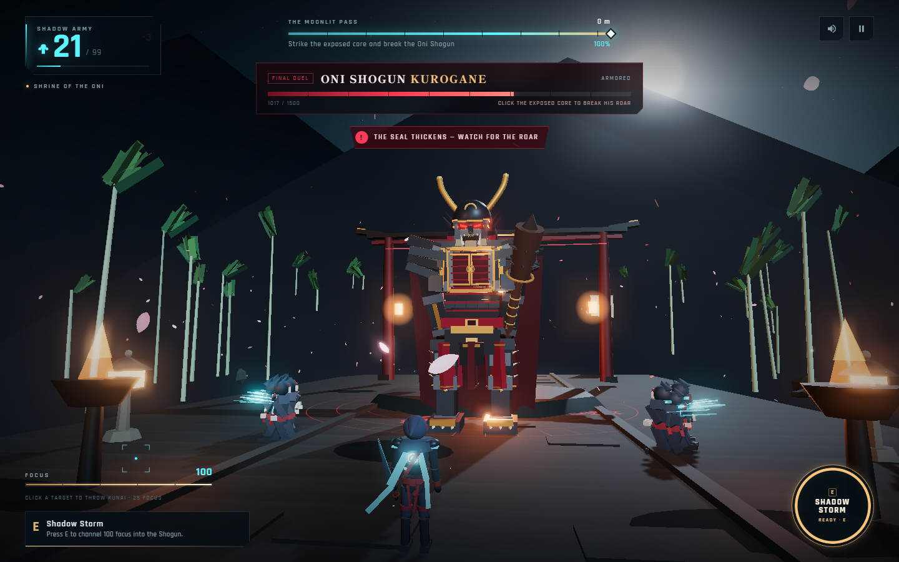
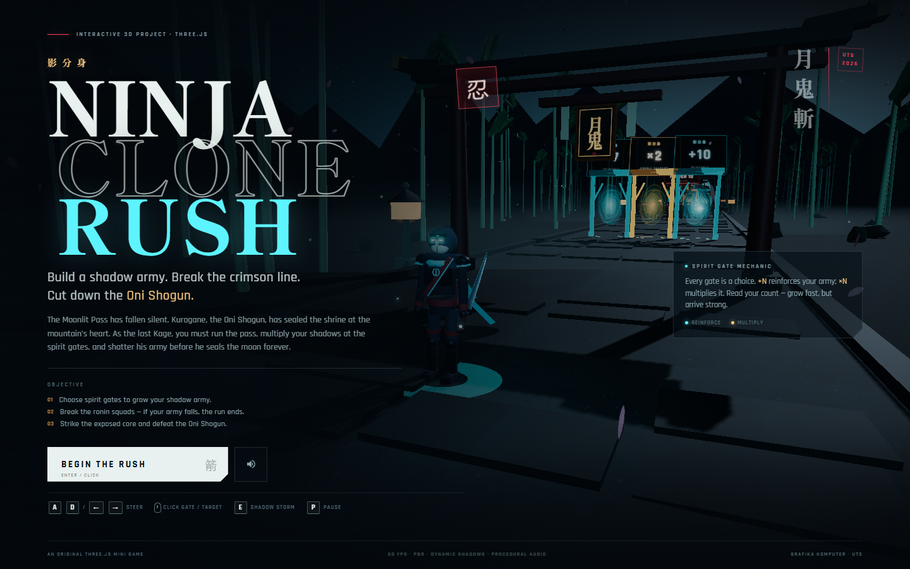
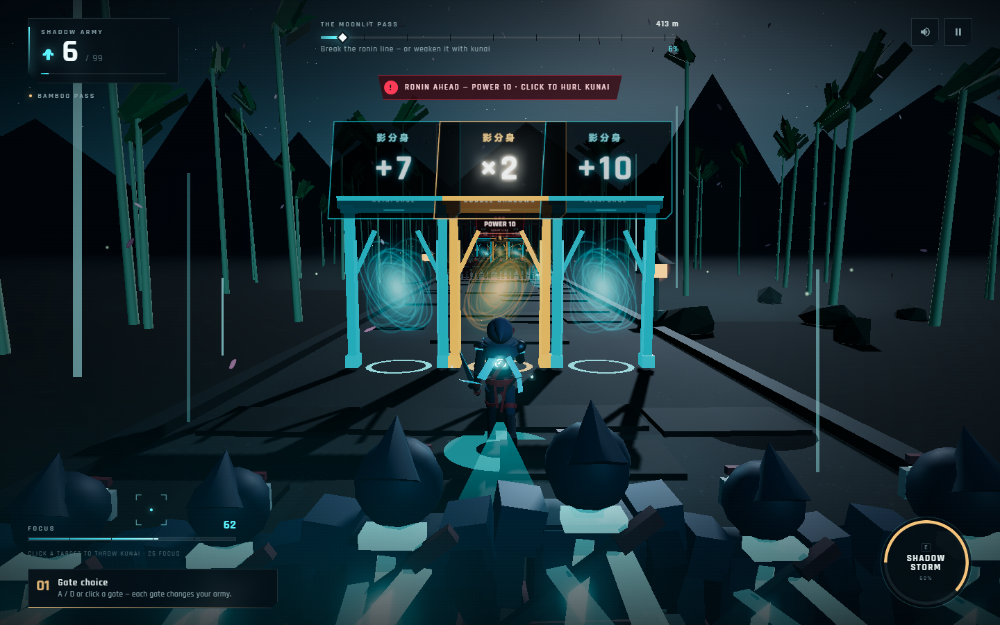
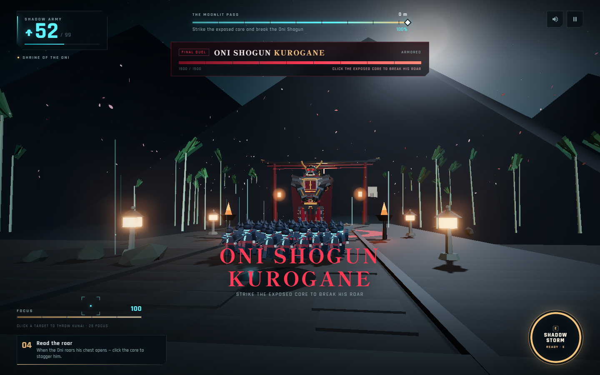
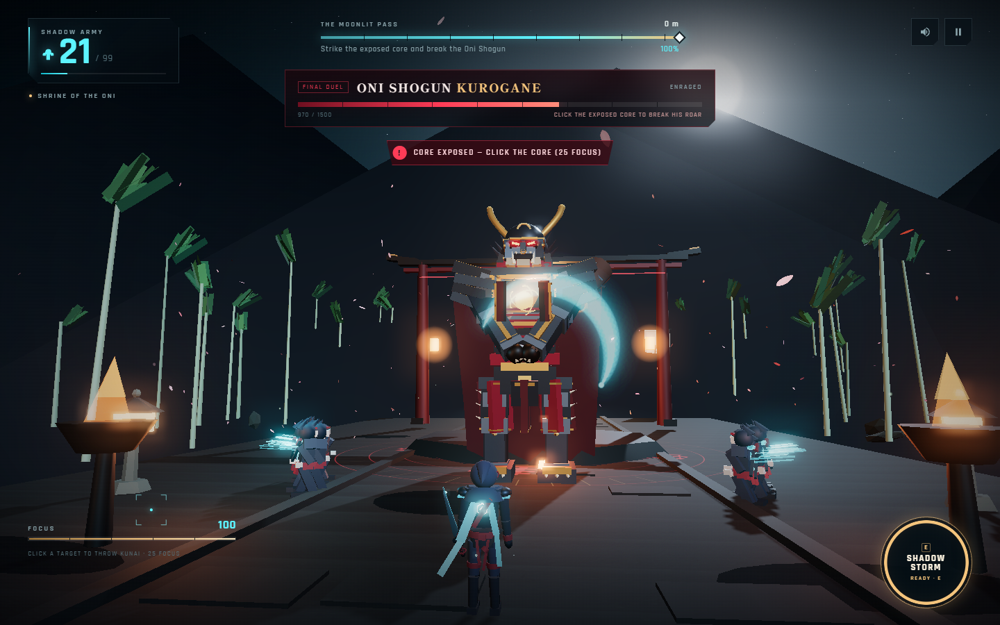
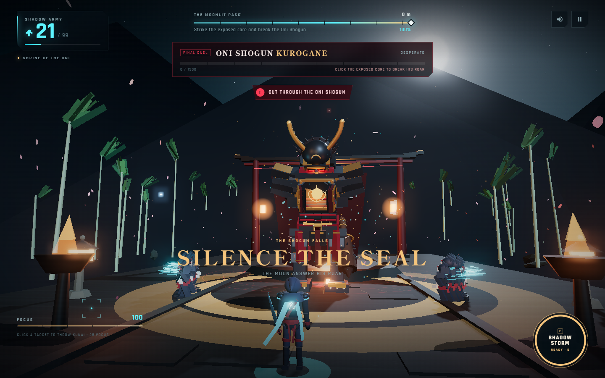
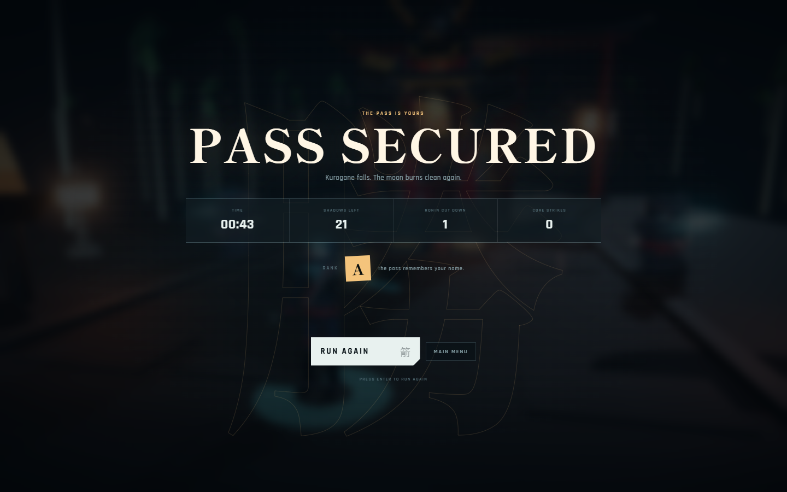

# NINJA CLONE RUSH

**Interactive 3D Project — Grafika Komputer (UTS 2026)**
Topik 8 — *Ninja Clone Rush* · Three.js · WebGL · JavaScript



> Bangun pasukan bayangan. Tembus barisan ronin. Tebas Oni Shogun.

---

## 1. Identitas Proyek

| Item | Keterangan |
| --- | --- |
| Nama proyek | **Ninja Clone Rush** |
| Jenis | 3D mini game / interactive 3D project |
| Topik | Topik 8 — Ninja Clone Rush |
| Mata kuliah | Grafika Komputer |
| Tahun | 2026 |
| Teknologi | JavaScript, Three.js r169, HTML, CSS, Vite |
| Repositori | `[URL repository GitHub]` |
| Video demo | `[URL video demo — YouTube/Drive]` |

### Anggota Kelompok

| Nama | NRP | Peran utama |
| --- | --- | --- |
| `[Nama Anggota 1]` | `[NRP]` | World & environment, boss art, post-processing, VFX, build/deploy |
| `[Nama Anggota 2]` | `[NRP]` | Gameplay systems, clone army, UI/HUD, audio, testing, dokumentasi |

> Jika dikerjakan sendiri, hapus baris kedua dan sesuaikan tabel kontribusi.
> Ganti seluruh placeholder `[...]` sebelum submission.

---

## 2. Deskripsi

**Ninja Clone Rush** adalah mini game aksi 3D di mana pemain berperan sebagai Kage terakhir dari klan bayangan. Oni Shogun **Kurogane** telah menyegel kuil di Moonlit Pass dan akan mengunci bulan selamanya. Pemain berlari menembus jalur gunung, memilih gerbang roh untuk memperbanyak klon, menghancurkan barisan ronin, lalu menghadapi Kurogane dalam duel bos.

Kekuatan pemain berasal dari **jumlah klon**: semakin besar pasukan bayangan, semakin besar damage yang diterima bos. Kuncinya adalah memilih gerbang dengan risiko dan hasil yang berbeda — menambah klon secara langsung, atau mengalikannya bila pasukan sudah cukup besar.

Seluruh scene, model, animasi, tekstur, UI, VFX, dan audio dibuat khusus untuk proyek ini. Tidak ada game jadi, template, atau tutorial yang disalin.

---

## 3. Cara Menjalankan

### Prasyarat

- Node.js 18 atau lebih baru (diuji pada Node.js 24)
- Browser modern dengan WebGL 2 (diuji pada Chrome/Edge)
- npm

### Mode development

```bash
npm install
npm run dev
```

Buka `http://localhost:5173`. Klik **BEGIN THE RUSH** atau tekan `Enter`. Audio baru aktif setelah interaksi pertama (kebijakan autoplay browser).

### Build produksi

```bash
npm run build
npm run preview
```

Hasil build ada di `dist/`. Vite dikonfigurasi dengan `base: './'`, sehingga build dapat di-host di root domain maupun subfolder (misalnya GitHub Pages).

### Regenerasi model ninja (opsional)

Model hero adalah aset GLB orisinal yang dibuat secara prosedural oleh skrip proyek:

```bash
npm run build:model
```

Perintah ini menulis ulang `public/assets/models/ninja.glb` beserta enam clip animasinya.

---

## 4. Kontrol

| Aksi | Desktop | Mobile |
| --- | --- | --- |
| Pindah jalur | `A` / `D` atau `←` / `→` | Tombol ◀ / ▶ di kiri bawah |
| Pilih gerbang roh | Klik gerbang (diarahkan otomatis) | Tap gerbang |
| Lempar kunai ke squad ronin | Klik squad (biaya 25 focus) | Tap squad |
| Hancurkan core bos | Klik core yang terbuka (biaya 25 focus) | Tap core |
| Shadow Storm | `E` (butuh 100 focus) | Tombol SHADOW STORM kanan bawah |
| Pause / resume | `P` atau `Esc` | Tombol pause kanan atas |
| Mulai / ulang | `Enter` | Tombol di layar |
| Suara on/off | Tombol speaker | Tombol speaker |

Kursor diganti reticle khusus. Saat diarahkan ke target yang valid, reticle menampilkan label `GATE`, `SQUAD`, atau `CORE` dan target menyala. Ini adalah umpan balik visual sebelum pemain menekan tombol.

---

## 5. Gameplay dan Aturan

### Alur permainan

1. **Spirit gates (6 baris).** Setiap baris menawarkan tiga gerbang: `+N` menambah klon, `×2` / `×3` mengalikan klon. Pilihan gerbang langsung mengubah besar pasukan. Melewati gerbang juga menambah focus.
2. **Ronin squads (5 squad).** Squad berdiri di jalur dengan power 10, 18, 28, 40, dan 54. Bila pasukan menabrak squad, terjadi clash dan klon berkurang. Pemain dapat melempar kunai (25 focus) untuk melemahkan squad dari jarak jauh, atau memakai Shadow Storm untuk menghapus squad berikutnya.
3. **Focus orbs.** Bola focus di sepanjang jalur memulihkan focus untuk kunai, core strike, dan ultimate.
4. **Duel bos.** Kurogane memiliki 1500 HP dan tiga fase. Ia menyerang dengan **Sealing Roar** (membuka core, tetapi mengoyak sebagian pasukan) dan **Kanabo Slam**. Saat core terbuka, pemain harus mengklik core dalam jendela waktu singkat: serangan tepat memberi **200 damage** dan membuat bos stagger; serangan terlambat hanya memberi 80 damage.
5. **Victory.** HP bos habis → cinematic kemenangan → layar hasil dengan waktu, sisa klon, squad yang dihancurkan, core strike, rank, dan best run.

### Menang, kalah, dan restart

- **Menang:** HP Oni Shogun mencapai 0.
- **Kalah:** seluruh klon habis sebelum segel bulan pecah.
- **Restart:** tombol **RUN AGAIN** atau `Enter` pada layar hasil; tersedia juga restart dari menu pause. Best run disimpan di `localStorage`.

### Rank

| Rank | Syarat |
| --- | --- |
| **S** | Waktu ≤ 52 detik dan sisa klon ≥ 55 |
| **A** | Sisa klon ≥ 28 atau waktu ≤ 64 detik |
| **B** | Selain itu |

---

## 6. Pemenuhan Requirement Grafis

| Kebutuhan | Implementasi dalam proyek |
| --- | --- |
| Scene utama + kamera + renderer + ground/environment | Satu scene Moonlit Pass di `src/World.js`: kamera perspective, renderer WebGL, jalan batu, arena kuil, torii, bambu, lantern, dan gunung prosedural. |
| Minimal 3 jenis objek/aset | Hero GLB, gerbang roh, squad ronin, orb focus, bos Oni, torii, lantern, batu, bambu. |
| Relasi parent–child pada scene graph | Rig bos berlapis (`root → torso → head/arm/leg/cape/core`, kanabo sebagai child lengan); hero memiliki grup pedang dan syal; setiap gerbang memiliki frame, portal, papan, dan hitbox; clone army tersusun dalam formasi. |
| Aset GLTF/GLB | `public/assets/models/ninja.glb` — model ninja orisinal dengan rig dan enam clip: Idle, Run, Slash, Storm, Victory, Defeat. Dibuat dengan `tools/export-ninja.mjs`. |
| Material PBR | `MeshStandardMaterial` / `MeshPhysicalMaterial` untuk armor, logam, kayu, kain, batu, dan kulit; roughness/metalness bervariasi; environment map dari PMREM. |
| Minimal 2 cahaya | Moonlight directional (shadow-casting), boss key light, boss warm rim light, lantern point lights, flame lights, shrine light, serta ambient/hemisphere. |
| Bayangan cast & receive | PCFSoft shadow map; karakter, bos, gerbang, ronin, dan bambu mencast shadow; jalan dan arena menerima shadow. |
| Environment | Sky dome shader kustom (bintang, bulan, glow horizon), `FogExp2`, gunung, bambu yang bergoyang lewat vertex shader, kelopak bunga, fireflies. |
| Minimal 2 animasi | Enam clip karakter GLB; animasi bos (windup, slam, roar, stagger, death); portal berputar; cape simulation; bambu sway; lantern sway; clone idle/run; cinematic kamera. |
| Minimal 3 interaksi | (1) Memilih jalur/gerbang, (2) melempar kunai ke squad, (3) menghancurkan core bos, (4) Shadow Storm, (5) pause, (6) kontrol suara, (7) kontrol sentuh. |
| Interaksi memakai `THREE.Raycaster` | `src/Game.js` melakukan raycast terhadap hitbox tak terlihat bertipe `gate`, `squad`, dan `core`; hover memakai reticle kustom dan highlight, klik mengeksekusi aksi. |
| Umpan balik visual | Highlight target, reticle, floating text (`+12`, `-200`), flash layar, getar kamera, FOV pulse, stagger bos, announce banner, perubahan HUD. |
| Minimal 2 VFX | Slash arc, burst partikel, kunai projectile, ribbon trail, speed lines, ground shockwave ring, gerbang portal, ledakan core, kelopak, fireflies, bloom, slow-motion. |
| Kamera dan UI/HUD | Kamera follow dengan look-ahead, cinematic intro bos dan victory, camera shake; HUD jumlah klon, progress jalur, boss HP/fase, focus, tutorial, warning, announce, menu, pause, hasil, best run. |
| Objective, win/lose, restart | Tujuan ditampilkan di menu dan HUD; kondisi menang/kalah jelas; restart dari hasil, pause, dan menu. |
| Performa dan console bersih | Clone memakai `InstancedMesh`, VFX memakai object pool, shadow map dan pixel ratio menyesuaikan perangkat, seluruh aset lokal. Build produksi diuji tanpa error/warning di console. |

### Detail teknis yang menonjol

- **Aset orisinal sepenuhnya.** Model ninja, squad ronin, gerbang, bos, tekstur, dan audio tidak memakai file eksternal. Model dan tekstur dibuat lewat skrip/kode; audio disintesis dengan Web Audio API.
- **Post-processing.** `EffectComposer` + `RenderPass` + `UnrealBloomPass` + `OutputPass`, tone mapping ACES, dengan kekuatan bloom berbeda untuk desktop dan mobile.
- **Raycast terhadap hitbox tak terlihat.** Target interaksi memakai mesh hitbox yang tidak dirender; hover dan klik diuji dengan `THREE.Raycaster`. Reticle kustom menampilkan label target.
- **Formasi clone.** Pasukan mengikuti formasi wedge di belakang hero, dengan `InstancedMesh` untuk menjaga performa saat jumlah klon mendekati 99.
- **Audio prosedural.** Taiko, angin, gong, kunai, roar, dan UI tone dibuat dengan oscillator/noise, sehingga tidak ada aset audio pihak ketiga.
- **Determinisme dan pengujian.** Dunia memakai seeded RNG; alur lengkap (menu → run → clash → boss → core → victory → result → retry), pause, kunai, defeat, dan tampilan mobile telah diuji otomatis di browser headless.

---

## 7. Struktur Proyek

```
ninja-clone-rush/
├─ index.html                 # Markup HUD, menu, pause, loading, result
├─ package.json
├─ vite.config.js
├─ public/
│  └─ assets/
│     └─ models/
│        └─ ninja.glb         # Model + 6 animasi orisinal
├─ src/
│  ├─ main.js                 # Bootstrap, loading aset, font, model
│  ├─ Game.js                 # State machine, gameplay, input, Raycaster
│  ├─ World.js                # Scene, sky shader, lighting, environment
│  ├─ Stage.js                # Gerbang, squad ronin, orb, jalur
│  ├─ Boss.js                 # Model, rig, AI, fase, serangan bos
│  ├─ Hero.js                 # Loader GLB, mixer, transisi animasi
│  ├─ CloneArmy.js            # InstancedMesh, formasi, animasi klon
│  ├─ VFX.js                  # Particle pool, slash, trail, ring, kunai
│  ├─ Audio.js                # Audio prosedural Web Audio
│  ├─ UI.js                   # HUD, menu, hasil, tutorial, reticle
│  ├─ utils.js                # Tekstur canvas, geometri, RNG, shader helper
│  ├─ style.css               # Desain UI, responsif, animasi CSS
│  └─ assets/fonts/           # Subset font OFL
├─ screenshots/               # Screenshot game
├─ tools/
│  └─ export-ninja.mjs        # Generator model & animasi GLB
└─ README.md
```

---

## 8. Screenshot

### Menu



### Spirit gates



### Kedatangan Oni Shogun



### Core terbuka



### Victory



### Layar hasil



---

## 9. Tantangan dan Solusi

| Tantangan | Solusi |
| --- | --- |
| Membuat game yang terasa seperti dunia nyata tanpa aset eksternal | Membangun lingkungan 3D berlapis: jalan batu, torii raksasa, kuil, bambu bergoyang, lantern, gunung, kabut, bintang, dan bulan dalam satu scene yang konsisten. |
| Membuat model ninja dan animasi sendiri | Menulis generator model prosedural di Node menggunakan Three.js dan `GLTFExporter`, termasuk rig, weight, dan enam clip animasi. |
| Bos terbaca jelas di tengah bloom dan cahaya malam | Menyeimbangkan emissive, roughness, metalness, intensitas lampu arena, dan bloom threshold; mendesain ulang topeng, helm, serta palka core agar siluet dan titik lemah terbaca. |
| Interaksi 3D yang presisi | Memakai hitbox tak terlihat dan `THREE.Raycaster`, reticle kustom, serta hover highlight sehingga pemain tahu target sebelum menekan. |
| Kamera dan gerbang saling menutupi | Menghapus tiang tengah frame gerbang dan menata ulang frame agar kamera tetap bersih saat melewati gerbang. |
| HUD bertumpuk di layar kecil | Mengukur bounding box HUD, lalu menambahkan offset responsif untuk warning, announce, dan boss bar pada beberapa breakpoint. |
| Performa dengan puluhan klon dan VFX | `InstancedMesh`, object pooling, jumlah partikel terbatas, shadow map adaptif, dan pixel ratio yang menyesuaikan perangkat. |
| Game feel | Slow-motion singkat, camera shake, FOV pulse, flash, floating damage, announce banner, dan SFX prosedural pada setiap aksi penting. |

---

## 10. Pembagian Kontribusi

> Sesuaikan dengan kontribusi aktual. Kedua anggota harus memahami seluruh bagian proyek karena demo video menampilkan keduanya.

| Area | Anggota 1 | Anggota 2 |
| --- | --- | --- |
| Konsep, gameplay, balancing | 50% | 50% |
| World, lighting, environment | 70% | 30% |
| Model GLB, animasi, dan rig | 60% | 40% |
| Boss, clone army, VFX | 55% | 45% |
| UI/HUD, menu, responsif | 40% | 60% |
| Audio, pengujian, dokumentasi | 40% | 60% |

---

## 11. Aset dan Kredit

| Aset | Sumber | Lisensi |
| --- | --- | --- |
| Three.js r169 | https://threejs.org | MIT |
| Vite 5 | https://vitejs.dev | MIT |
| Font **Rajdhani** (subsets) | Indian Type Foundry, via Google Fonts | SIL Open Font License 1.1 |
| Font **Shippori Mincho** (subsets) | FONTDASU, via Google Fonts | SIL Open Font License 1.1 |
| `ninja.glb` (model, rig, 6 animasi) | Dibuat khusus untuk proyek ini oleh `tools/export-ninja.mjs` | Milik kelompok |
| Squad ronin, gerbang, torii, kuil, bos, orb | Dibuat prosedural dengan Three.js di dalam proyek | Milik kelompok |
| Seluruh tekstur (batu, kayu, kain, portal, partikel, glow) | Digambar prosedural dengan Canvas 2D | Milik kelompok |
| Seluruh SFX dan ambience | Disintesis dengan Web Audio API | Milik kelompok |
| Desain UI/HUD, ikon SVG, dan animasi CSS | Dibuat khusus untuk proyek ini | Milik kelompok |
| Screenshot | Diambil dari build proyek | Milik kelompok |

Tidak ada model, tekstur, audio, game jadi, atau template pihak ketiga yang digunakan selain pustaka dan font di atas.

---

## 12. Catatan Orisinalitas dan Bantuan AI

Ide, komposisi scene, aturan gameplay, desain bos, UI/HUD, dan seluruh aset dibuat khusus untuk proyek ini. Tidak ada source code game lain, fork, atau tutorial yang disalin.

Pengembangan dibantu alat AI sebagai asisten coding (scaffolding, debugging, dan iterasi visual). Seluruh keputusan desain, pengujian di browser, dan hasil akhir ditinjau oleh kelompok; setiap anggota dapat menjelaskan bagian yang menjadi tanggung jawabnya.

---

## 13. Video Demo

`[URL video demo]`

Rencana isi video (kedua anggota tampil):

1. Pembukaan dan penjelasan singkat tema serta tujuan game.
2. Menu, kontrol, dan penjelasan mekanik gerbang.
3. Demonstrasi run lengkap: gerbang, clash ronin, kunai, dan Shadow Storm.
4. Duel bos: membaca serangan, membuka core, klik core, hingga victory.
5. Penjelasan fitur grafis: PBR, lighting, shadow, sky/fog, GLB animation, scene graph, Raycaster, VFX, dan post-processing.
6. Layar hasil, restart, dan penutup.

---

## 14. Checklist Submission

- [ ] Nama anggota dan NRP sudah diisi.
- [ ] URL repository GitHub sudah diisi dan repository dapat diakses penguji.
- [ ] URL video demo sudah diisi dan dapat diakses.
- [ ] `npm install && npm run build` berhasil di mesin bersih.
- [ ] Screenshot utama tersedia di repository.
- [ ] README memuat deskripsi, gameplay, kontrol, fitur grafis, cara menjalankan, kontribusi, tantangan, dan kredit aset.
- [ ] `node_modules/` dan `dist/` tidak ikut di-commit.
- [ ] Proyek diunggah ke Classroom sebelum tenggat.
